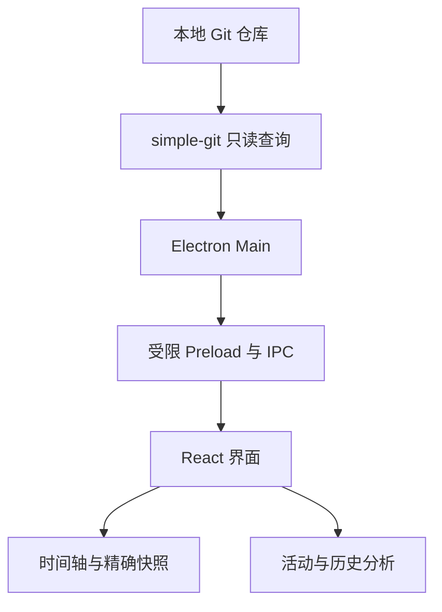
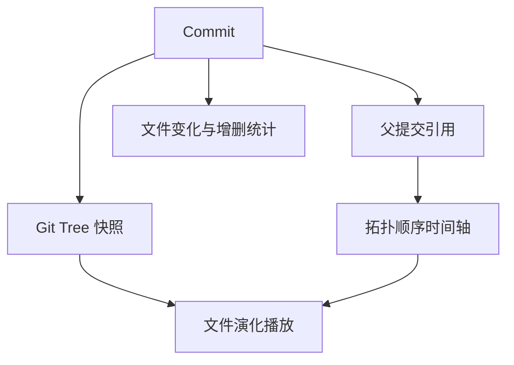

<div align="center">


# GitAtlas

**Git 提交历史可视化时光机**  
See how your repository grew.

[Windows 下载](https://github.com/fqxxzyw/GitAtlas/releases/latest) · [构建与测试](https://github.com/fqxxzyw/GitAtlas/actions) · [架构说明](docs/ARCHITECTURE.md)

</div>

Git 仓库不只有“现在这一份代码”。它保存着一系列项目状态之间的变化。GitAtlas 把这些状态变成可以播放的时间轴，让你回到第一次提交，看文件出现、目录扩展、代码重构，再回到今天。

这是一个 **本地、只读的 Windows 桌面工具**，不会代替 Git 客户端，不执行 commit、checkout、push、pull、reset、merge。

## 体验与设计

visionOS 启发的空间分层、Liquid Glass 风格半透明材质、弹性导航与磁性按钮，结合 Windows 11 原生窗口控制、系统圆角与 Mica 背景。内容区是 React，窗口外壳是 Electron；并非 WinUI 3 控件应用，也不包含苹果专有渲染实现。

- 默认跟随系统主题，可选浅色 / 深色。
- 动效遵循 `prefers-reduced-motion`；时间轴吸附到离当前位置很近的里程碑。
- 使用 Windows 标题栏覆盖层保留原生最小化、最大化、关闭与系统窗口行为。
- Mica 取决于 Windows 11 版本、透明效果和节能设置；不支持时使用普通背景。

## 功能

| 视图 | 可以做什么 |
| --- | --- |
| 项目概览 | 提交、文件、贡献者、跨度；文件增长曲线；按文件数量统计扩展名；客观里程碑 |
| 时光回溯 | 播放 / 暂停、首尾跳转、拖动进度、0.5×–4×；真实文件树；新增 / 修改 / 删除 / 重命名；第一父提交 Diff |
| 文件足迹 | 查找文件、沿第一父链追溯重命名、创建与最后修改时间、变更记录 |
| 生长视图 | HTML/SVG 目录布局随时间变化；按改动规模查看最大提交 |
| 活动节奏 | 3 个月 / 6 个月 / 1 年 / 全部热力图；每周频率；活跃星期和小时 |
| 贡献者 | 按姓名排列的提交、文件与增删统计，不做绩效评分 |
| 快照对比 | 两个提交间的新增、移除、内容或模式修改，以及本地 Git 增删行统计 |

其他功能：本地与远程分支引用、最近 10 个仓库、增量复用元数据缓存、带进度与取消的扫描、组合搜索、元数据 JSON 导入导出、内置合成演示。

## 安装

1. 在 [Releases](https://github.com/fqxxzyw/GitAtlas/releases) 下载 `GitAtlas-Setup-x64.exe`（安装版）或 `GitAtlas-Portable-x64.exe`（便携版）。
2. 阅读本地仓库前安装 [Git for Windows](https://git-scm.com/download/win)，确认终端可执行 `git --version`，安装 Git 后重启 GitAtlas。
3. 点击“打开本地仓库”选择项目目录。也可以直接体验演示，或导入此前导出的 GitAtlas JSON。

首次版本为未签名应用，Windows 可能显示未知发布者。Release 同时提供 SHA-256 校验值。便携版免安装，设置和缓存仍保存在系统用户应用数据目录，并非完全无痕。

## 截图与演示

截图来自实际应用的 Windows 自动化测试。概览、时间轴、生长视图和深色主题使用明确标注的合成演示数据；Diff 截图使用测试创建的真实本地 Git 仓库。

测试工作流产出 `GitAtlas-UI-evidence` 截图包，成功发布后也附在 Release。`docs/*.png` 在原生端到端测试中生成，不用设计稿冒充截图。

无需 Git 也可体验：

```sh
npm ci
npm run dev:web
```

网页模式只能导入 JSON 和使用演示，不能读取本地仓库。JSON 不携带完整源码，网页端无法恢复真实 Diff。

## 开发

需要 Node.js **22.12+**、npm 和 Git，桌面开发推荐 Windows 11 x64。

```sh
git clone https://github.com/fqxxzyw/GitAtlas.git
cd GitAtlas
npm install
npm run dev
```

`npm install` 会获取 Electron 运行时。`npm run dev` 启动 Vite 和 Electron。更改主进程或 preload 后请重启开发命令；渲染进程支持热更新。

```sh
npm run lint             # TypeScript strict + ESLint
npm run test             # 纯函数与真实临时 Git 仓库测试
npm run build            # Renderer + main + preload
npm run build:desktop    # Windows x64 NSIS + portable
npm run test:ui          # 已构建应用的原生 Electron 冒烟测试
```

PowerShell 中测试打包后的程序：

```powershell
$env:GITATLAS_EXECUTABLE = 'release/win-unpacked/GitAtlas.exe'
npm run test:ui
```

安装包输出至 `release/`。Linux 交叉生成 Windows NSIS 包需要 Wine；仓库的 GitHub Actions 使用 Windows 原生环境构建，无此要求。

## 快捷键与搜索

| 快捷键 | 操作 |
| --- | --- |
| Space | 播放 / 暂停 |
| ← / → | 上一次 / 下一次提交 |
| Home / End | 最早已加载 / 最新提交 |
| Ctrl / Cmd + O | 打开仓库 |
| Ctrl / Cmd + F | 搜索提交 |
| Ctrl / Cmd + E | 导出历史 |
| F | 提交图归位到列表顶部 |

输入框获得焦点时不会触发播放器快捷键。

```text
login
author:zheng login
file:Header.tsx after:2026-01-01
message:"fix navigation" before:2026-05-01
```

条件使用 AND 组合。日期为包含边界的日历日期，基于提交记录里的当地日期。

## 工作方式



提交元数据和文件变更转换成独立 TypeScript 模型，`ls-tree` 提供每个提交的完整文件树。Merge 的统计与 Diff 相对于第一父提交计算，父关系全部保留。切换分支只选择查询目标，不 checkout，不触碰真实工作区。



更多语义、安全边界、缓存与容量说明见 [ARCHITECTURE.md](docs/ARCHITECTURE.md)。

## 隐私

- 没有 GitHub 登录、GitHub API、遥测、分析 SDK 或云同步。
- 生产应用拒绝网络请求，不上传仓库、源码或提交记录。
- JSON 只含提交元数据、文件路径、Git 对象 ID、变更统计和快照；移除邮箱、仓库绝对路径、源码和 Diff。
- **提交说明、作者名称和文件路径本身也可能敏感。分享前请检查。**
- 缓存仅含元数据和快照索引；Diff 按需读取，不缓存源码。

## 项目结构

```text
electron/              原生窗口、受限 IPC、Git 服务和解析
src/core/              数据模型、纯函数、搜索、导入导出和状态
src/components/        各视图、文件树、图表与播放器
src/App.tsx            应用外壳、快捷键、主题与原生操作
src/styles.css         空间布局、玻璃材质、响应式与减少动态效果
tests/                 单元和真实 Git 集成测试
scripts/smoke.mjs      原生 Electron UI 与打包启动测试
docs/                  架构、Release 说明、测试生成截图
.github/workflows/     Windows 检查、构建和有条件的 Release
```

技术栈：Electron、React、TypeScript、Vite、Tailwind CSS、Framer Motion、Lucide、Zustand、ECharts、simple-git、Zod、Vitest、Playwright。

## 测试与发布

测试覆盖增删改/重命名、Unicode/空格/制表符路径、二进制文件、Merge 快照、分支只读、脏工作区与暂存区保持、截断历史基线、缓存更新、查询、里程碑、导出隐私、错误映射与无效 JSON。

Windows CI 执行安装、lint、单元/集成测试、打包、**启动生成的 exe** 并验证 preload 隔离、播放器、搜索焦点、分支切换、真实 Diff、导入导出、主题和主要页面，同时保存实际截图。只有主分支提交说明包含 `[release]` 且全部检查成功时才创建当前版本 Release。

## 限制

- 首次读取最近 500 次提交，每批再加载 500 次，最多 20,000 次；快照总量上限 200 万条。超限会明确提示。
- 统计基于已加载历史；不会把截断历史的起点称为项目创建时刻。浅克隆无法推断缺失的祖先。
- 线性播放按拓扑顺序，跨越并行分支时相邻画面不一定互为父子。每个画面仍是该提交的真实完整快照。
- 文件年龄在缺少创建事件时显示未知；文件生命周期按第一父链追溯。
- 不虚构代码总行数或估计语言行数；语言组成按文件数量统计。
- 导入 JSON 最大 50 MiB；不携带源码，故不提供真实 Diff。文件对比按路径，重命名计为新增与移除。
- Diff 显示最多 2 MiB；特别大的 diff 在读取阶段仍可能占用较多内存。
- 三条可视图轨道覆盖常见 DAG，复杂并行分支压缩显示，精确父关系以提交详情为准。
- 取消扫描在当前 Git 批次结束后生效，不立即中止系统进程。
- 活动热力图最多绘制最近 100 年，防止异常导入日期生成无界网格。
- 活动时间不等于实际工作时长：**Commit time does not perfectly represent actual coding time.**
- Win11 Mica、窗口吸附与不同 DPI 的最终效果需以实际设备为准，CI 无法覆盖所有显卡与系统配置。

## Roadmap

更紧凑的快照索引、百万级历史流式分析、更多复杂 DAG 轨道、文件生命周期的多父链选择、代码签名。保持只读和离线优先。

## Contributing & License

欢迎提交 Issue 和 Pull Request。请阅读 [CONTRIBUTING.md](CONTRIBUTING.md)。[MIT](LICENSE)。
